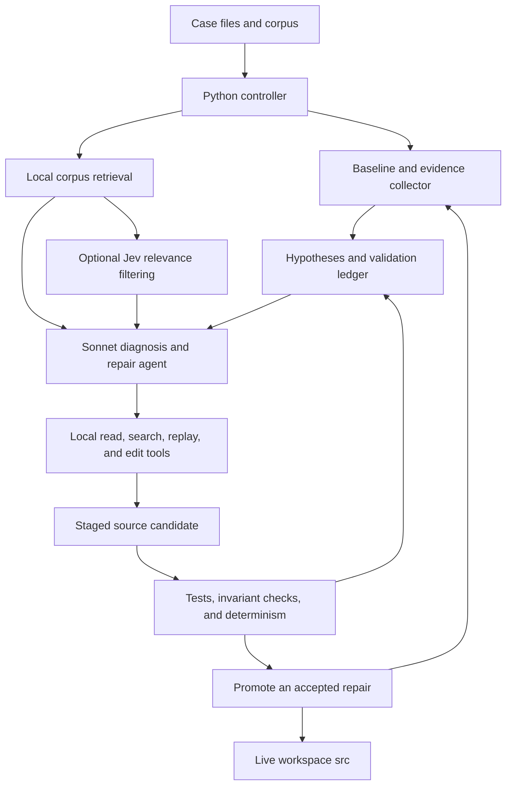

# Proposed fixer design

## Recommendation

Build a small Python controller around **one Sonnet 4.6 agent that diagnoses and repairs code**, with local tools for corpus retrieval, simulator execution, patching, and validation. Use Jev optionally to filter retrieved documentation. Keep the controller responsible for deadlines, spending, source checkpoints, and deciding which validation gates have passed.

The main loop is:

**Reproduce → retrieve the relevant contract → explain the failure → patch → validate → investigate remaining failures.**

This design follows the scoring rules: a fix must survive fault schedules and seeds, public and private regression tests can zero a case, and removing one bug can expose another. The objective is to preserve verified repairs while continuing to discover defects in an unfamiliar service.

## 1. Requirements that shape the design

| Requirement | Design consequence |
| --- | --- |
| Only `src/` changes are graded | Produce service repairs; put generated scenarios, traces, and checkpoints in scratch space. |
| Hidden services differ from practice services | Discover source layout, contracts, and scenario schema at runtime. |
| Public tests pass before any fix | Use tests as regression protection and simulator checks as evidence of repair. |
| Each bug must pass all 20 hidden seeds | Validate causal protocol behavior across seeds and relevant faults. |
| Some bugs form a chain | Keep a hypothesis ledger and rerun the incident after each accepted repair. |
| 900 seconds, $3 per bug, 2 CPUs, 4 GB | Bound context, model output, subprocess time, and concurrent simulations. |
| Approximately 26M corpus tokens | Retrieve selected sections using local search. |
| Only Sonnet and Jev are allowed at runtime | Implement tools locally and use the supplied model proxy. |
| Grading uses source present at termination | Maintain a verified live source snapshot throughout the run. |

Treat `C3_DEADLINE` and `C3_BUDGET_USD` as authoritative. The budget provides resource capacity; hypotheses and experiments determine how many defects need attention.

## 2. Architecture



### Controller

- Resolve workspace and corpus from their environment variables and explicitly change to the workspace directory.
- Convert the Unix deadline into a monotonic time allowance at startup.
- Own all writes and child processes; expose bounded tools to the agent.
- Maintain original, candidate, and best accepted source snapshots.
- Record model usage, experiment timings, hypotheses, and patch decisions.
- Schedule cheap local work while model requests run. Use one scheduler for tests, replays, and determinism checks, capped at two compute processes including descendants, with a lower limit if memory requires it.

### Sonnet agent

Use a single tool conversation with explicit diagnosis, repair, and review steps. Its durable working state is a compact ledger with:

```text
observed failure and affected entity
causal event sequence
current contract and source locations
root-cause hypothesis
predicted result of a targeted experiment
candidate change
validation evidence and remaining uncertainty
```

A separate review call can inspect a risky protocol change when resources allow. Start with one agent and add runtime delegation only if practice measurements show a benefit. One edit owner keeps candidates consistent and avoids duplicated context costs.

### Tool interface

| Tool | Behavior |
| --- | --- |
| `list_files(root, pattern)` | Return a bounded file inventory. |
| `read_file(path, start, end)` | Read numbered lines from workspace or corpus. |
| `search(root, query, mode, limit)` | Search source or selected corpus directories with bounded output. |
| `trace_slice(run, entities, event_types)` | Return relevant histories from a trace retained on disk. |
| `replay(scenario, seed, faults)` | Run the simulator, check its trace, and return a compact evidence bundle. |
| `run_tests(selection)` | Run original public tests against a staged candidate. |
| `write_probe(name, scenario)` | Create a scenario in scratch using the case's schema. |
| `apply_edits(base_hash, edits)` | Apply structured edits to staged `src/`; reject stale or ambiguous edits. |
| `validate(candidate, plan)` | Run controller-owned gates and store their results. |

Use subprocess argument lists, explicit working directories, timeouts, and process groups. Validate tool arguments and resolved paths locally, including symlink containment. Restrict source edits to staged `src/`. Read additional simulator implementation or case files when required to understand an unfamiliar interface.

## 3. Collect evidence before asking for a patch

At startup, read `case.json`, `SYMPTOM.md`, the service README, `INVARIANTS.md`, `scenario_schema.md`, and corpus `INDEX.md`. Inventory source files and summarize functions/classes, RPC handlers, persistent records, and logged event names.

Run public tests and replay the incident seed first. Collect remaining public seeds as time allows. Save the original results for comparisons with later candidates.

The simulator wrapper must distinguish execution from correctness:

```sh
python -m sim replay --scenario public --seed N --out SCRATCH_RUN
python -m sim check --trace SCRATCH_RUN/trace.jsonl
```

The practice CLI returns `0` from `replay` when execution completes, even if invariants fail. `check` returns `1` for violations and prints JSON containing `violations` and `invariants`. Configuration errors, runtime errors, tool timeouts, and invariant failures should remain distinct observations.

### Compact trace summaries

Stream JSONL from disk and retain:

- Failure families grouped by invariant and meaningful detail.
- Representative job, task, epoch, worker incarnation, and operation identifiers.
- Unresolved client actions and their last meaningful transitions.
- Relevant message sends/replies, GPU effects, durable state transitions, and fault events.
- Message counts and repeated transitions that indicate excessive retries.

Order events by simulator sequence and time. Node log timestamps come from different local clocks; use logs to find source locations and use trace identifiers to reconstruct causality.

A liveness violation can have no timestamp, and its cause may be much earlier than the end of the run. Follow the affected action or operation's full history instead of relying only on a small time window. Keep raw traces available for additional agent queries.

## 4. Retrieve authoritative contracts efficiently

Use the corpus hierarchy and exact incident vocabulary:

1. Read `INDEX.md` and its document status/version information.
2. Identify the service from case metadata and README.
3. Search its current overview, operational notes, API reference, and runbooks.
4. Follow references to current platform contracts.
5. Search background research when an unresolved question needs it.

Search keys should include log tokens, error codes, RPC methods, invariant descriptions, and symbols from the relevant code. Rank sections using literal hits and local lexical relevance. Preserve each section's path, heading, line numbers, version, and status when presenting it to Sonnet.

CURRENT contracts override contradictory SUPERSEDED documents according to the corpus index. Older documents can help explain legacy assumptions in code, provided their status remains explicit.

Associate claims with the service's applicable runtime/API version and explicit supersession information. A higher version number in a filename alone does not establish authority.

Jev can answer a narrow question such as whether a candidate section contains a contract relevant to a particular symptom. Apply it to a bounded lexical shortlist, keep direct matches and explicitly referenced contracts, and allow Sonnet to widen the search. Retrieval filtering must preserve useful evidence even when Jev rejects a section.

Read the small set of relevant files fully when affordable. Avoid indexing or sending the complete background corpus on every case. At the pack's $3/M uncached input rate, 26M tokens would cost approximately $78 before any output.

## 5. Repair loop and multiple bugs

For each hypothesis, Sonnet should explain the specific failed transition and predict an observable consequence of the repair. Common audit questions include:

- Does a timeout preserve the possibility that a side effect already occurred?
- Are retries idempotent and their operation IDs stable across crashes?
- Are ownership, incarnation, epoch, and sequence checks current when an action occurs?
- Is safety rechecked after an `await`, timeout, or backoff?
- Are acknowledgements sent only after necessary state is durable?
- Can recovery resume every pending obligation, including historical attempts?
- Does release completion, rather than release acknowledgement, control capacity accounting?
- Do retries respect the documented pacing and simulated randomness rules?

These are investigation prompts. The agent still has to establish the service's actual protocol from its code and contracts.

### Targeted experiments

Use the shipped schema to construct small probes around the relevant transition. Examples include a lost submit reply, a duplicate late commit, a restart after an acknowledgement, or a retry that occurs after lease expiry.

A new probe should reproduce the suspected failure on the previous source snapshot before it is used as evidence of repair. Keep it in the regression set after acceptance. Generate only faults and workloads supported by the documented deployment, and allow enough quiescence time for liveness expectations.

The practice `--faults` argument replaces the entire fault block. Construct combined probes explicitly and preserve their intended fault interactions. Adjust workload-dependent expectations to the reduced workload while retaining the invariant checks.

### Acceptance and discovery

Accept a partial repair when public tests pass, its targeted failure is resolved, and control runs provide evidence that it preserves existing behavior. Investigate any newly observed failure before classifying it as a regression: an earlier fix may have enabled a later protocol stage to run for the first time.

Track causal transitions and failure families. Raw violation counts can increase after a useful fix because more work completes or reaches another defective stage. When a hypothesis needs several related edits, keep that candidate staged until the necessary validation passes.

Key each obligation and experiment by source hash, scenario hash, seed, invariant, and relevant entity/epoch. Normalize incidental error text while preserving the identities needed to distinguish two different failures.

After each accepted repair, replay the original incident and refresh the ledger. Continue until the relevant validation set passes and the contract audit has no supported unresolved hypothesis, or the remaining resources require finalization.

### Example: a report sent after lease expiry

The public A2 material illustrates this workflow:

1. `sim check` identifies a worker report sent after the grantor lease expired.
2. The current lease runbook requires checking validity immediately before every protected send, including retries.
3. The agent inspects the report loop and the holder validity method. A cached `lost` flag may lag actual expiry until the renew task wakes.
4. A probe forces a report timeout/backoff while renewals stop.
5. A focused repair checks current validity before each report attempt and follows the existing lease-loss/adoption protocol.
6. Validate normal reporting, expiry, fencing, and a later holder adopting the same operation; rerun the incident for additional causes.

The submitted fixer discovers this relationship at runtime. Practice-specific paths and patches serve as development examples.

## 6. Validation and source promotion

Validate candidates in a separate case tree containing real copies of unchanged simulator, tests, scenarios, and required metadata plus the proposed source. Helpers can derive the case root from `__file__`, so symlinking them to the original case can test the wrong source. Use fresh subprocesses, an explicit staged working directory, and controlled import paths/root overrides. Prevent generated bytecode from appearing in the live source diff.

Freeze a candidate while validation runs and attach every result to its source hash. Further edits create a new candidate; results from another source version cannot satisfy its gates.

Run gates in increasing cost order:

1. Parse changed Python files and check the diff's path boundaries.
2. Reproduce/check the targeted failure and representative successful controls.
3. Run all public tests and previously accepted probes.
4. Check supplied public seeds and a bounded selection of new seeds.
5. Exercise the relevant fault families and a supported combined profile.
6. Repeat a scenario/seed in fresh processes and compare trace hashes.

The practice CLI also exposes `sweep` and `determinism`; discover supported options before using them on a new service. Select extra seeds and profiles using measured replay duration and the remaining deadline. A full Cartesian product of faults and seeds would consume the case budget unnecessarily.

I3 goodput requires reference message counts supplied by the grader. Local message deltas and retry-rate checks can detect likely amplification; they cannot certify the hidden I3 threshold. Private regression tests and hidden fault schedules also remain unavailable during a case.

### Keep the live source reviewable

- Leave the last accepted source live while a candidate is being edited and tested.
- Before promotion, save backups and a journal listing the candidate hash and changed files.
- Prepare replacement files before entering the short installation step.
- Install complete files using same-filesystem atomic replacement; handle additions and deletions in the journal.
- Defer ordinary termination during the short installation and restore the prior snapshot on an incomplete installation.
- Verify the installed source hash matches the candidate, then run all public tests and relevant smoke/repro checks from the actual workspace; roll back on an installation-specific failure.
- Stop promotions sufficiently before the deadline to finish this validation and cleanup.

Atomic replacement protects individual files; a multi-file installation still needs recovery and deadline headroom. Do not depend on the grader's five-second SIGKILL grace period to finish work.

Preserve required logging, protocol behavior, and the simulator's deterministic runtime primitives. Changes should repair the contract violation and retain the evidence used to check it.

## 7. Time and model spending

Start with an adaptive schedule rather than fixed iteration counts:

| Phase | Initial allowance for a 900-second case |
| --- | --- |
| Discovery, baseline, initial retrieval | Approximately 60–90 seconds |
| Diagnosis and repair iterations | Most of the remaining time |
| Final validation, rollback allowance, cleanup | Reserve 90–120 seconds, increased for slow tests |

Stop launching an operation when its measured duration plus finalization reserve cannot fit. Exit early when the validation plan is complete and no supported hypothesis remains. Keep roughly 20% of the model budget available for late corrective work until finalization begins.

Use the Anthropic Messages API through `ANTHROPIC_BASE_URL`, pin Sonnet to the allowed model, and use `JEV_DECISIONS_URL` for Jev. Local custom tools fit the proxy rules. Validate returned tool arguments rather than depending on unsupported response-format fields.

The proxy automatically applies prompt caching. Keep system instructions, tool definitions, and stable case context unchanged, append compact results, and compact growing history into the ledger when needed. A useful starting context target is 20–40k tokens; measure this on practice cases.

The pack's proxy reserves requests conservatively using uncached input estimates:

```text
estimated_input_tokens = ceil(serialized_prompt_characters / 4)
reservation_usd ≈ estimated_input_tokens × 3.75 / 1,000,000
                + requested_max_tokens × 15 / 1,000,000
```

Thus a 30k estimated-input request with a 6k output ceiling reserves approximately $0.203 even if much of its input is cached. Choose output limits for the action, and start with a modest explicit thinking budget if extended thinking helps in practice.

Maintain a usage ledger. The practice proxy additionally exposes a `/budget` endpoint under the OpenAI base URL; use it opportunistically with a fallback because README does not promise it. Treat interrupted requests as potentially charged. On 402, compact or reduce the reservation once when useful; stop model work when funds are exhausted. Bound retries for transient proxy errors within both budgets.

Streaming can improve responsiveness. Collect a complete tool call or patch before applying it; incomplete responses must leave the accepted source intact. Give model requests an absolute cancellation deadline using a cancellable client or managed request worker; a SIGTERM flag and per-read socket timeout alone cannot bound a blocked request. On shutdown, cancel requests and terminate child process groups, finish or recover a promotion, and exit before the deadline.

## 8. Implementation and practice plan

Suggested structure:

```text
fixers/autonomous/
  Dockerfile
  run.sh
  fixer/
    main.py          # controller and scheduler
    model.py         # proxy calls, tool loop, usage accounting
    tools.py         # bounded local tools
    retrieval.py     # corpus navigation, search, optional Jev filtering
    evidence.py      # trace summaries and hypothesis ledger
    validation.py    # simulator/tests and comparison results
    patches.py       # staging, source hashes, promotion, rollback
    prompts.py       # diagnosis, repair, and review instructions
```

Implement in this order:

1. Environment/deadline handling, staged cases, simulator/check wrapper, tests, and safe promotion.
2. Sonnet tool loop with layered corpus search and an evidence ledger.
3. Targeted probes, adaptive seed validation, and budget accounting.
4. Jev filtering and optional review only when experiments show improved quality or time.

Bake Python ≥3.12, PyYAML, pytest, the API client, and search tooling into a small `linux/amd64` image. The entrypoint takes no arguments and explicitly changes to `C3_WORKSPACE`. Ship the fixer and dependencies without development case data.

Use all six practice cases to measure bugs fixed, test regressions, runtime, spend, and the cause of failed repairs. Log structured decisions and retain the grader's patch/evaluation artifacts. Compare retrieval and validation variants, and assess transfer by tuning on one practice codebase and evaluating on the other. Both practice services are still only an approximation of hidden generalization.

Grade the exact final image on every practice case. Prepare the half-page write-up from measured behavior, preserve the development chat logs, and submit the image with its source and Dockerfile.

## Evidence and current verification

This proposal is based on static review of [README.md](README.md), [RULES.md](RULES.md), the [minimal fixer](fixers/examples/minimal-llm/fix.py), [proxy behavior](proxy/server.py), the [corpus index](corpus/build/practice/INDEX.md), and public practice source, simulator interfaces, and current runbooks.

The proposal has been implemented in [fixers/autonomous](fixers/autonomous/README.md), including source snapshots, corpus retrieval, native Sonnet tools, deterministic probes, repair review, budget/deadline controls and recoverable promotion. Jev filtering remains a possible extension.

All 173 automated tests and all six baseline practice workflows pass in a local Python 3.12 environment. Real B1 grading reached the proxy but model requests were rejected because the upstream account had zero credits, producing no patch and no model spend. Autonomous repair performance and exact Docker image grading remain unmeasured. See the [engineering review](fixers/autonomous/REVIEW.md) for evidence and outstanding gates.
